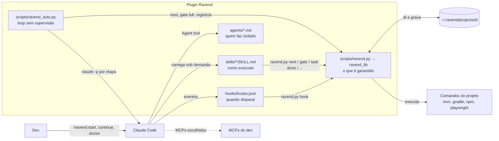
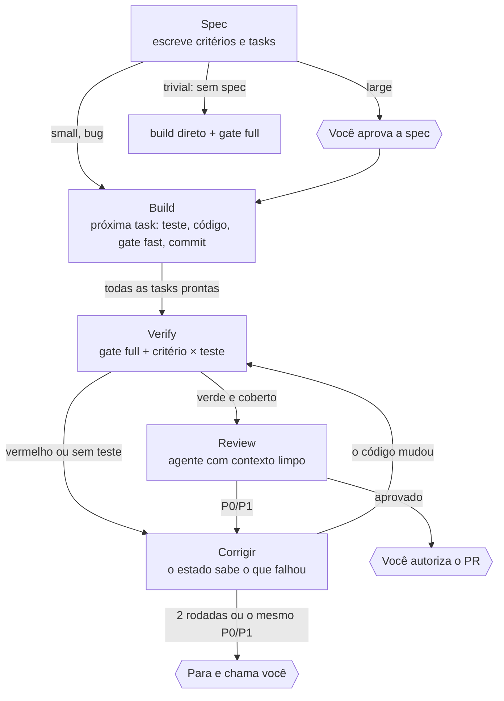

# Arquitetura do Ravend

Como o plugin funciona por dentro: camadas, fluxo, onde cada coisa mora, o que é garantido por código e o que depende do modelo seguir instruções. Para *usar* o Ravend, o [README](../README.md) basta.

Mantenha este documento junto com o código: uma mudança de estrutura (arquivo novo, módulo novo, etapa nova) atualiza a seção correspondente no mesmo PR.

## Sumário
- [Visão geral](#visão-geral)
- [Camadas](#camadas)
- [Linguagens e formatos](#linguagens-e-formatos)
- [Diretórios](#diretórios)
- [Instalação e distribuição](#instalação-e-distribuição)
- [O fluxo: quem decide o próximo passo](#o-fluxo-quem-decide-o-próximo-passo)
- [Uma sessão por dentro (hooks)](#uma-sessão-por-dentro-hooks)
- [Quality gate](#quality-gate)
- [`ravend auto` (sem supervisão)](#ravend-auto-sem-supervisão)
- [Integração com MCPs](#integração-com-mcps)
- [Dados locais](#dados-locais)
- [Módulos do runtime](#módulos-do-runtime)
- [Código × prompt: o que é garantido](#código--prompt-o-que-é-garantido)
- [Testes e evals](#testes-e-evals)
- [Catálogo de arquivos](#catálogo-de-arquivos)
- [Pontos de atenção](#pontos-de-atenção)
- [Glossário](#glossário)

## Visão geral

Ravend é um plugin do Claude Code. Um plugin pode trazer *skills* (instruções que viram comandos `/ravend:…`), *agents* (subagentes com contexto próprio), *hooks* (scripts disparados por eventos da sessão) e arquivos auxiliares. O Ravend usa os quatro.

A regra que guia a arquitetura: **o que precisa ser garantido roda em código Python, não em instrução de prompt.** O modelo pode esquecer ou ignorar uma instrução; um script que lê um exit code ou um hook que bloqueia a sessão, não.

> **Em linguagem natural:** pense numa linha de montagem. O Claude é o operário habilidoso. As skills são os procedimentos na parede. O runtime (`ravend_lib`) é o inspetor com régua de verdade e também o quadro que diz qual é a próxima estação. Os hooks são a catraca na saída da fábrica.

## Camadas

| Camada | Onde | Formato | Responsabilidade |
|---|---|---|---|
| **Prompts** | `skills/`, `agents/` | Markdown + frontmatter YAML | Como executar cada etapa. Lidos pelo modelo. |
| **Runtime** | `scripts/` | Python (só biblioteca padrão) | O que é garantido: ordem das etapas (`next`), gate, registros de estado, hooks, MCPs, runner sem supervisão. |
| **Integração** | `.claude-plugin/`, `hooks/` | JSON | Como o Claude Code descobre, instala e conecta o plugin. |
| **Dados locais** | `~/.ravend/` (fora do repo) | JSON, Markdown | Perfil do gate, specs, registros, lições. Um por dev, por projeto. |
| **Qualidade** | `tests/`, `evals/` | Python, YAML, Bash | Testes do runtime e avaliações do comportamento do modelo. |



## Linguagens e formatos

Nada é compilado e não há dependências externas: `python3`, `git` e o Claude Code bastam.

| Formato | Onde | Por quê |
|---|---|---|
| Markdown + frontmatter YAML | skills, agents, references | Formato exigido pelo Claude Code. O frontmatter (`name`, `description`, `argument-hint`, `model`, `tools`) é configuração; o corpo é o prompt. Corpo em inglês (menos tokens); `description` e `argument-hint` em pt-BR, entre aspas (um `#` sem aspas vira comentário YAML). |
| Python 3.8+, só biblioteca padrão | scripts, tests | Já existe em todo Linux/macOS de dev; zero `pip install`. |
| JSON | manifestos, hooks, `profile.json`, `state.json` | Exigido pelo Claude Code e lido nativamente pelo Python. |
| YAML | `evals/*/case.yaml` | Formato do `claude plugin eval`. |
| Bash | `evals/*/scaffold.sh`, `evals/fixtures/` | Monta o repositório de teste dos evals. |

## Diretórios

```
ravend/
├── .claude-plugin/        plugin.json (nome, versão) · marketplace.json (o repo é o próprio marketplace)
├── hooks/hooks.json       liga 4 eventos da sessão a `ravend.py hook <evento>`
├── scripts/
│   ├── ravend.py          ponto de entrada da CLI (hooks, skills, comando `ravend`)
│   ├── ravend_lib/        o runtime, um módulo por responsabilidade (ver "Módulos do runtime")
│   └── ravend_auto.py     `ravend auto`: o pipeline sem supervisão
├── skills/                um diretório por comando /ravend:<nome>
│   ├── start/ continue/ doctor/                  ← dia a dia
│   ├── init/ spec/ build/ verify/ review/ ship/ remember/   ← etapas e utilidades
│   ├── api-tests/ e2e-playwright/                ← como escrever testes
│   └── stack-spring/ stack-quarkus/ stack-angular/ stack-react/  (+ references/)
├── agents/                reviewer, verifier, implementer
├── tests/                 testes do runtime e do ravend auto (unittest)
├── evals/                 avaliações do comportamento do modelo (+ fixtures/make-shop.sh)
├── docs/ARCHITECTURE.md   este documento
├── README.md · CLAUDE.md · LICENSE · .gitignore · imgs/
```

Nada deste repositório é copiado para o projeto onde o dev trabalha. O que o Ravend produz vai para `~/.ravend/`; no projeto ficam só o código, os testes e o PR.

## Instalação e distribuição

| Instalador | Quando | Faz | Grava em |
|---|---|---|---|
| `/plugin install ravend --marketplace ferreiravpl/ravend` | uma vez por máquina | Lê `marketplace.json` → `plugin.json` e copia o plugin para o cache, numa pasta por versão. | `~/.claude/plugins/cache/ravend/ravend/<versão>/` |
| `/ravend:init` | uma vez por repositório, por dev | Detecta stacks, monta o `profile.json`, escreve `project.md`, pergunta quais MCPs usar, oferece o comando de terminal e termina com o `doctor`. Rodando de novo, pergunta o que refazer. | `~/.ravend/projects/<id>/` |
| `ravend.py install-cli` | opcional | Grava um script `ravend` que acha a versão instalada (via `installed_plugins.json`) e repassa tudo ao `ravend.py`. | `~/.local/bin/ravend` |

O Claude Code atualiza o plugin pela `version` do `plugin.json`: publicar sem subir a versão = quem já instalou não recebe. Não existe gancho de instalação para plugins, por isso a configuração conversada acontece no `/ravend:init`, e o hook `SessionStart` avisa quando o repositório ainda não tem perfil.

## O fluxo: quem decide o próximo passo

A ordem das etapas existe **num lugar só**: `next_action` em `ravend_lib/flow.py` (`ravend next` na CLI). O `/ravend:continue`, o `/ravend:start` e o `ravend auto` só perguntam e executam.



O que `next_action` lê, nesta ordem:

| Situação no disco | Ação |
|---|---|
| Nenhuma spec ativa / várias sem a da branch atual | `start` / `choose` |
| `status: done` ou `abandoned` | `done` |
| `status: draft` com `BLOCKING:` em *Open questions* | `answer` |
| `status: draft` | `approve` |
| Task `- [ ] T<n>` pendente | `build` (com `task`) |
| Sem verificação registrada para a impressão digital atual | `verify` |
| Última verificação deste código falhou | `fix` (`verify`) ou `human` após o limite |
| Sem review registrado para este código | `review` |
| Último review com P0/P1 | `fix` (`review`), ou `human` se repetiu os mesmos P0/P1 ou passou do limite |
| Tudo verde e aprovado neste código | `ship` |

**Impressão digital da árvore** (`tree_fingerprint` em `core.py`): copia o índice do git para um arquivo temporário, faz `git add -A` nele e `git write-tree`. É um hash do conteúdo de todos os arquivos, commitados ou não, sem tocar no índice real. Toda verificação e todo review são registrados com ela; se qualquer arquivo mudar, o registro deixa de valer e o passo é refeito.

**Registros feitos pelo runtime, não à mão** (para o `next` nunca ler um arquivo reformatado pelo modelo):

| Comando | Grava |
|---|---|
| `ravend task done <slug> T3` | marca a task em `spec.md`, loga e passa a spec para `in-progress` |
| `ravend verify record <slug> [--uncovered …]` | `state.json → verify[]`, com o resultado do último `gate full` **desta pasta**; recusa se esse gate não rodou neste código |
| `ravend review record <slug>` (JSON na entrada) | `state.json → reviews[]` e `review-N.md`; o veredito é derivado (qualquer P0/P1 = `CHANGES_REQUESTED`); recusa `--file` dentro do repositório |
| `ravend spec approve\|done\|abandon <slug> [--pr URL]` | status da spec e o link do PR |

O limite de rodadas vem de `profile.flow.max_fix_rounds` (padrão 2).

## Uma sessão por dentro (hooks)

Os quatro hooks rodam em toda sessão do Claude Code e saem sem fazer nada em repositórios sem perfil.

| Hook | Timeout | Faz | Por que é hook |
|---|---|---|---|
| `SessionStart` | 15 s | Injeta projeto, pasta de dados, stacks, MCPs escolhidos, notas, índice de lições e specs ativas (com a dica de `/ravend:continue`). Exporta `RAVEND_ROOT`, `RAVEND_DATA`, `RAVEND_SESSION_ID`. | O modelo sempre começa sabendo onde estão as coisas. |
| `PreToolUse` (Edit/Write) | 10 s | Nega edição de `protected_paths`. | Uma negação do harness não pode ser ignorada. |
| `PostToolUse` (Edit/Write) | 60 s | Roda o formatter do arquivo editado. | Formatação determinística, sem tokens. |
| `Stop` | 1800 s | Só com build armado (`ravend arm`): se o código mudou desde o último gate fast verde, roda o gate e bloqueia o encerramento se falhar. Após 3 bloqueios, libera e pede um humano. | Impede o "pronto!" com teste quebrado. |

## Quality gate

Uma lista de comandos **do próprio projeto** em `profile.json`. O Ravend decide quais rodar, onde, com quais arquivos e por quanto tempo; o veredito é o exit code.

1. **Arquivos alterados:** fast = árvore de trabalho vs HEAD + não rastreados; full = desde o `merge-base` com a branch base.
2. **`when`:** se nenhum arquivo alterado casa com o glob, o passo é pulado.
3. **Placeholders:** `{files}`, `{java_tests}`, `{gradle_tests}`, `{base}`. Placeholder vazio = passo pulado.
4. **Execução:** grupo de processos próprio (mata tudo no timeout), saída em memória e em `runs/`.
5. **Relatório:** só as linhas com cara de erro (até 25) e o final da saída.
6. **Estado:** `state/<pasta>/last-gate-<modo>.json` e, se passou, a impressão digital em `green.json`.

Passos com `needs_app` sobem a aplicação (`profile.app`), esperam o healthcheck e derrubam no fim. Para não disputar portas, o gate segura o lock `state/app.lock` enquanto a app roda, e `app start` recusa se a app de outra pasta ainda está viva.

## `ravend auto` (sem supervisão)

`ravend_auto.py` roda o pipeline sem sessão interativa. O controle é um loop Python que pergunta `next_action` a cada volta; o modelo é chamado por etapa com `claude -p` e precisa responder num JSON Schema fixo.

- **Sempre num worktree** irmão (`../<repo>-<slug>`, branch da feature). Lock por pasta (`state/<pasta>/run.lock`): uma execução por pasta, várias em paralelo em pastas diferentes.
- **O gate full é rodado pelo script** depois do verify, e o próprio script registra a verificação. O modelo não consegue declarar verde.
- **Review:** se a skill não conseguiu registrar o review neste código, o runner registra, reaproveitando o JSON completo do reviewer quando a skill chegou a guardá-lo.
- **Etapa que não muda o estado** (mesma ação e mensagem duas vezes) → para com saída 3, em vez de entrar em loop.
- **Skills da mesma versão do runtime:** se o checkout em execução não é o plugin instalado, passa `--plugin-dir` com ele.
- **Permissões por etapa** (`--allowedTools`): ferramentas base, `ravend.py`, cada comando do gate/app (o texto fixo até o primeiro placeholder, mais argumentos: `npx eslint {files}` libera `npx eslint *`, nunca `npx *`), os MCPs escolhidos só nas etapas do papel, `mcp__playwright` no verify se não houver MCP de navegador, `gh` só no ship.
- **MCPs de escopo local** ficam registrados pelo caminho da pasta principal; o runner os copia para um arquivo temporário (0600, apagado no fim) e passa com `--mcp-config`.
- Saídas: `0` concluído ou pausado de propósito · `1` erro inesperado · `2` configuração · `3` precisa de você.

## Integração com MCPs

O Ravend não traz MCPs próprios: descobre os do dev (`ravend mcp`) e pergunta, no `/ravend:init`, quais usar em cada papel.

- **Descoberta:** `~/.claude.json` (escopos user e local), `.mcp.json` do repo e `claude mcp list` (plugins, conectores do claude.ai, status). Guarda só nome, origem, transporte, uma dica (host da URL ou nome do pacote) e o prefixo `mcp__<nome normalizado>`; argumentos com valores, env e headers nunca saem.
- **Papéis** (`ROLES` em `mcp.py`, a fonte da verdade): `issues`, `git`, `context`, `docs`, `knowledge`, `design`, `browser`, `api`, `database`, `observability`, cada um com as etapas onde vale.
- **Escolha:** `profile.json → "integrations": {"<papel>": ["<servidor>"]}`. A sessão mostra as escolhas no início; cada skill lê `integrations` em `ravend.py project`; o `ravend auto` libera cada MCP só nas etapas do papel.

## Dados locais

```
~/.ravend/projects/<id>/            ← id vem do remote origin: igual em todo clone e worktree
├── profile.json        gate, formatters, app, paths protegidos, integrations, flow
├── project.md          notas do projeto (≤ 40 linhas), injetadas no início da sessão
├── knowledge/          index.md + uma lição por arquivo (/ravend:remember)
├── specs/<slug>/       spec.md · verify.md · review-N.md · state.json · evidence/
├── runs/               gate-<modo>-<data>-<pid>/ · auto-<data>-<pid>/ · app-*.log
└── state/
    ├── app.lock        lock da aplicação, compartilhado entre pastas
    └── <pasta>-<hash>/ last-gate-*.json · green.json · armed.json · stop-blocks.json · app.json · run.lock
```

Prós: vários devs no mesmo repo sem conflito nem lixo no git; cada um com seus comandos e MCPs; apagar a pasta "desinstala" o Ravend daquele projeto. Contras: specs e reviews não chegam ao time (o que o time vê é o corpo do PR); trocar de máquina exige `/ravend:init` de novo ou copiar o `profile.json`.

## Módulos do runtime

`scripts/ravend.py` só chama `ravend_lib.cli.main`. O pacote não tem dependências circulares: cada módulo importa apenas os que vêm antes nesta tabela.

| Módulo | Responsabilidade | Principais nomes |
|---|---|---|
| `core.py` | Identidade do projeto, pastas de dados, JSON/perfil, git, locks, impressão digital | `project_id`, `data_dir`, `state_dir`, `file_lock`, `load_profile`, `changed_files`, `tree_fingerprint` |
| `gating.py` | Quality gate e ciclo de vida da app | `resolve_step`, `run_cmd`, `failure_excerpt`, `gate`, `app_start`, `app_owner`, `app_stop` |
| `mcp.py` | MCPs do dev, papéis, permissões por etapa | `ROLES`, `mcp_servers`, `integrations`, `integration_tools`, `local_mcp_config` |
| `detection.py` | Detecção de stacks para o `init` | `detect` |
| `flow.py` | Specs, máquina de estados e registros | `next_action`, `mark_task_done`, `record_verify`, `record_review`, `set_spec_status`, `status` |
| `diagnostics.py` | `ravend doctor` | `doctor`, `print_doctor` |
| `hooks.py` | Os quatro hooks | `hook_session_start`, `hook_pre_edit`, `hook_post_edit`, `hook_stop` |
| `cli.py` | `argparse` (ajuda em pt-BR) e despacho; `hook` e `auto` são roteados antes do parse | `build_parser`, `main`, `install_cli` |

`import ravend_lib` expõe todos os nomes de todos os módulos num namespace só, usado pelo `ravend_auto.py` e pelos testes.

## Código × prompt: o que é garantido

| Regra | Interativo | `ravend auto` | Onde |
|---|---|---|---|
| Gate decide por exit code | código | código | `gating.gate` |
| Não encerrar com gate vermelho durante o build | código (hook Stop) | código (runner refaz o gate) | `hooks.hook_stop` · `Runner.gate_full` |
| Arquivos protegidos não são editados | código | código | hook PreToolUse |
| Formatação dos arquivos editados | código | código | hook PostToolUse |
| Ordem das etapas e limite de rodadas | decisão em código; a skill executa o que o `next` responde | código | `flow.next_action` |
| Verificação só vale para o código em que o gate rodou | código | código | `flow.record_verify` |
| P0/P1 nunca vira "aprovado" | código | código | `flow.record_review` |
| PR só com tudo verde e aprovado neste código | a skill consulta o `next` (prompt) | código (só chama o ship quando `next` = `ship`) | skill `ship` · `Runner._run` |
| MCP só nas etapas do papel | prompt | código | skills · `allowed_tools` |
| Teste antes do código (TDD) | prompt + eval | prompt + eval | skill `build` · eval `build-tdd-gate` |
| Reviewer não altera código | ferramentas restritas (Bash ainda poderia) | idem | `agents/reviewer.md` |
| Verifier não toca em produção | só prompt | só prompt | `agents/verifier.md` |

## Testes e evals

**Testes do runtime** (`tests/`, `unittest`, 41 testes, ~15 s). Criam repositórios git reais em pastas temporárias e rodam a CLI de verdade. O `ravend auto` é testado com um `claude` falso no PATH que imita os efeitos das skills (escreve a spec, marca tasks com `task done`, corrige arquivos), então o loop inteiro roda sem chamar a API.

Cobrem: identidade, placeholders e gate; hooks; descoberta de MCP sem segredos; papéis por etapa; estado por worktree e locks; app disputada entre pastas; comando `ravend`; o ciclo completo da máquina de estados (aprovar, tasks, verify recusado sem gate, fix, review derivado, ship, done); escalação por finding repetido; escolha de spec pela branch; `doctor`; e o `ravend auto` (pronto para PR, `--pr`, pausa e resume, trivial, rodada de review, finding repetido, gate refeito pelo script, limite de rodadas, permissões estreitas, lock de pasta, MCP local no worktree).

**Evals** (`evals/`, `claude plugin eval`). Medem o comportamento do modelo com as skills no repositório de exemplo "shop" (Node, sem dependências). No sandbox dos evals o Bash não grava arquivos, então os registros do runtime falham e as skills usam o plano B (gravar o arquivo com a ferramenta Write).

| Caso | Prova |
|---|---|
| `spec-tier-trivial` | Mudança trivial não gera spec. |
| `spec-tier-large` | Demanda grande gera spec large com Given/When/Then, design e tasks, sem perguntas no headless e sem gravar no repo. |
| `build-tdd-gate` | Build escreve teste primeiro, roda o gate e responde o JSON do headless. |
| `review-catches-boundary-bug` | O reviewer pega um bug de limite que a suíte verde não pega. |
| `continue-follows-next` | O `continue` pergunta ao `next` e segue para o build, sem pular etapas. |
| `ship-refuses-unready` | O `ship` recusa (sem push, sem PR) quando o `next` não diz `ship`. |
| `init-asks-what-to-redo` | Com perfil existente, o `init` resume o que existe e pergunta o que refazer. |

## Catálogo de arquivos

| Arquivo | Responsabilidade | Por que existe / formato | Contras |
|---|---|---|---|
| `.claude-plugin/plugin.json` | Nome, versão, autor, ícone. | O Claude Code identifica e atualiza o plugin por ele. | Versão manual: esquecer de subir = sem atualização. |
| `.claude-plugin/marketplace.json` | O repo como marketplace de um plugin. | Instalar sem marketplace de terceiros. | Um marketplace por plugin. |
| `hooks/hooks.json` | Liga 4 eventos a `ravend.py hook`. | Hooks rodam no harness, fora do alcance do modelo. | Roda em toda sessão; Stop é síncrono. |
| `scripts/ravend.py` | Ponto de entrada da CLI. | Caminho estável para hooks, skills e o comando `ravend`. | — |
| `scripts/ravend_lib/*.py` | O runtime (ver "Módulos do runtime"). | Um módulo por responsabilidade, só biblioteca padrão, testável. | Sem Windows nativo (`fcntl`, grupos de processo). |
| `scripts/ravend_auto.py` | `ravend auto`. | O loop sem supervisão precisa ser código. | Depende de flags do CLI do Claude (`--json-schema`, `--mcp-config`); cada etapa é uma sessão nova (sem cache entre etapas). |
| `skills/start` | Começa uma demanda: spec → `continue`. | Comando único para o dev. | — |
| `skills/continue` | Executa o que o `next` responde, em loop, até um checkpoint. | O dev não precisa saber em que etapa está. | Seguir o `next` é instrução; a decisão é código. |
| `skills/doctor` | Mostra o `ravend doctor` e oferece correções. | Diagnóstico sem ler logs. | — |
| `skills/init` (+ `references/profile.md`) | Configura o repo: gate, notas, MCPs, comando de terminal. | Comandos de build variam demais para adivinhar. | É a etapa mais conversada; o eval cobre só o caso "perfil existente". |
| `skills/spec` (+ `references/spec-template.md`) | Classifica o tamanho e escreve a spec. | Uma spec proporcional em vez de quatro artefatos. | O tamanho é julgamento do modelo. |
| `skills/build` | Tasks test-first, gate fast, commit; correções quando `next` = `fix`. | Onde o código nasce. | "Teste antes" é instrução (coberta por eval). |
| `skills/verify` | Gate full, matriz critério × teste, testes que faltam, `verify record`. | "Pronto" com evidência. | A matriz é montada pelo modelo. |
| `skills/review` | Despacha o `reviewer` e registra com `review record`. | Contexto limpo para revisar. | O reviewer não usa MCPs; a skill repassa o que coletar. |
| `skills/ship` | Push e PR quando `next` = `ship`; `spec done`. | O PR leva a evidência ao time. | No interativo, a pré-condição é checada pelo modelo lendo o `next`. |
| `skills/remember` | Guarda lições do projeto. | Evita repetir erros sem inflar o contexto. | Local por dev. |
| `skills/api-tests`, `skills/e2e-playwright` | Como escrever testes de API e E2E. | Padrão mínimo de qualidade de teste. | `api-tests` cobre só Spring e Quarkus. |
| `skills/stack-*` (+ `references/testing.md`) | Particularidades de Spring, Quarkus, Angular, React. | Armadilhas de versão; "codebase primeiro". | Manutenção conforme as stacks evoluem; sem Vue. |
| `agents/reviewer.md` | Review independente (opus, só leitura). | Independência real. | Bash ainda poderia alterar arquivos. |
| `agents/verifier.md` | Testes E2E/API com o MCP de navegador (sonnet). | Isola snapshots enormes. | "Não alterar produção" é instrução. |
| `agents/implementer.md` | Uma task `[P]` num worktree (sonnet). | Paralelismo real em specs grandes. | Só para tasks com arquivos disjuntos. |
| `tests/test_ravend.py` | Runtime. | Garantias precisam de teste real. | — |
| `tests/test_ravend_auto.py` | `ravend auto` com `claude` falso. | O loop sem custo de API. | O falso pode divergir do CLI real. |
| `evals/*` | Comportamento do modelo. | Prompts também regridem. | `--runs 1` tem variação; rode de novo antes de concluir que regrediu. |
| `README.md` | Uso, sempre o estado atual. | Porta de entrada. | — |
| `CLAUDE.md` | Regras para quem desenvolve o plugin com o Claude. | Mantém as decisões entre sessões. | — |

## Pontos de atenção

1. **Hook de Stop síncrono.** Enquanto o gate fast roda, a sessão espera. Mantenha o fast abaixo de 2 minutos.
2. **Formatos internos do Claude Code.** O comando `ravend` lê `installed_plugins.json`, a descoberta de MCP faz parsing do texto de `claude mcp list` e o prefixo `mcp__<nome>` assume a normalização atual. Há fallback e testes, mas uma mudança no Claude Code pode exigir ajuste.
3. **Registros em ambiente só leitura.** Onde o Bash não grava (sandbox dos evals), `task done`, `verify record` e `review record` falham e as skills gravam o arquivo à mão. Fora do sandbox, o caminho é sempre o runtime.
4. **Verifier e reviewer.** "Não alterar produção" (verifier) e "só leitura" (reviewer, que tem Bash) são instrução. Um hook por agente fecharia isso.
5. **O tamanho da demanda é julgamento do modelo**, coberto pelos evals de tier mas sujeito a variação em casos de fronteira.
6. **Evals com `--runs 1`** mostram variação real: um caso pode falhar numa rodada e passar na seguinte. Antes de concluir que houve regressão, rode o caso de novo com `--case`.
7. **Mensagens de erro do `argparse`** ("invalid choice", "required") continuam em inglês; a ajuda está em português.
8. **Windows nativo** não é suportado (use WSL).

## Glossário

| Termo | Significado |
|---|---|
| AC | Critério de aceite em Given/When/Then, marcado com o nível do teste (`[unit]`, `[api]`, `[e2e]`, `[visual]`). |
| Arm / disarm | Liga/desliga o hook de Stop para a sessão atual. |
| Checkout / pasta | Uma cópia de trabalho do repo: o clone principal ou um worktree. |
| Fingerprint | Hash do conteúdo da árvore de trabalho, commitado ou não. |
| Gate fast / full | Comandos do projeto que decidem se o código está ok: só o que mudou / o que o CI rodaria. |
| Headless | Execução sem sessão interativa (`claude -p`), usada pelo `ravend auto`. |
| `next` | A máquina de estados: dado o que está no disco, qual é a próxima ação. |
| P0 / P1 / P2 | Severidade de um finding. P0/P1 bloqueiam. |
| Papel (role) | Uso de um MCP no pipeline (issues, git, context…), com as etapas onde vale. |
| Profile | `profile.json`, a configuração local do Ravend para um projeto. |
| Slug | Nome curto da spec, usado como id. |
| Tier | Tamanho da demanda: trivial, small, large, bug. |
| Worktree | Outra pasta de trabalho do mesmo repositório, em outra branch. |
